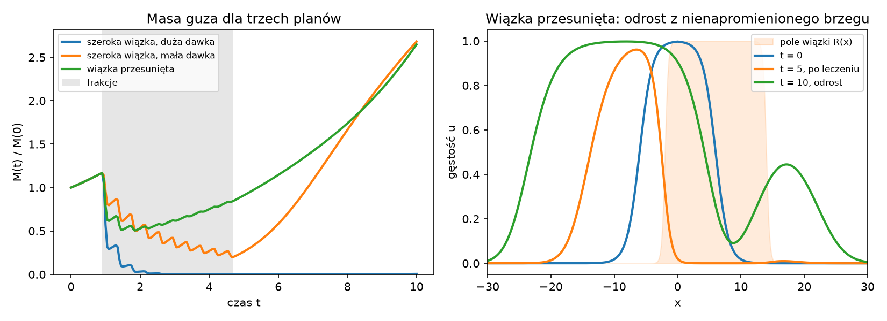

# Radioterapia guza przy niedopasowanym polu napromieniania

Krzysztof Kapera, Kacper Bieniasz · Informatyka Systemów Złożonych, AGH 2026/27 · prowadzący W. Dzwinel

Opis projektu, który rośnie razem z nim: po każdym zadaniu dopisujemy wyniki do sekcji „Postęp”. Plan pracy jest w [PLANS.md](../PLANS.md).

## Problem

Guz nowotworowy nie ma ostrej granicy: komórki dzielą się i wnikają w sąsiednią tkankę, a obraz MRI pokazuje tylko jego gęstą część. Dlatego pole napromieniania łatwo ustawić za wąsko albo trochę obok guza. Model GliODIL odtwarza komórki także poza granicą widoczną w MRI (Balcerak i in. 2025). Dopasowanie trójwymiarowego modelu do jednego pacjenta trwa jednak dziesiątki minut: w GliODIL 45 ± 20 min na pacjenta na GPU (tamże, s. 14).

**Pytanie projektu:** co dzieje się z guzem, gdy pole napromieniania nie pokrywa go dokładnie, i czy da się to przewidzieć szybko, szybszym modelem zastępczym zamiast pełnego solvera.

Temat z listy prowadzącego: „Radioterapia — wpływ niedopasowania pola promieniowania do guza”.

## Model

```latex
\frac{\partial u}{\partial t} = D\,\nabla^2 u + \rho\, u\left(1-\frac{u}{K}\right) - \beta\, R(x)\, U(t)\, u
```

| Człon | Znaczenie |
| --- | --- |
| u(x, t) | gęstość komórek guza w miejscu x i chwili t |
| D∇²u | naciekanie: komórki wędrują do sąsiedniej tkanki |
| ρu(1 − u/K) | wzrost: komórki dzielą się, aż wypełnią dostępne miejsce K |
| βR(x)U(t)u | radioterapia: R(x) to pole wiązki, U(t) harmonogram dawek, β wrażliwość komórek |

Liczymy w 1D, w jednostkach bezwymiarowych: czas w 1/ρ, długość w √(D/ρ), gęstość w K. 2D tylko, jeśli starczy czasu.

**Dawka.** Każda frakcja to wąski impuls w U(t) o całce 1, więc w środku wiązki jedna frakcja zostawia ułamek e^(−β) komórek (S = exp(−∫βU dt)). Dawki zapisane jako gładkie impulsy mają też Szubert, Bialy, Dzwinel (eq. 1–4). Odpowiednik modelu liniowo-kwadratowego to β = α·d + β_LQ·d²: dla frakcji 2 Gy i parametrów z TumorTwin (α = 0,05 Gy⁻¹, β_LQ = 0,005 Gy⁻²) β ≈ 0,12.

**Pokrętła i czego się spodziewamy:**

| Parametr | Co opisuje | Spodziewany wpływ |
| --- | --- | --- |
| D | naciekanie tkanki | szerszy i szybszy front; bez leczenia biegnie z prędkością 2√(Dρ) |
| ρ | tempo podziałów | szybszy wzrost przed leczeniem i szybszy odrost po nim |
| β | wrażliwość na promieniowanie | jaka część komórek ginie w jednej frakcji |
| r | połowa szerokości pola | za wąskie pole: guz odrasta z obu brzegów |
| s | przesunięcie pola względem guza | odrost po stronie, której pole nie objęło |
| U(t) | liczba i odstęp frakcji | granica między zanikiem a częściową odpowiedzią |

**Co mierzymy:** masę guza M(t) = ∫u dx, najmniejszą masę po leczeniu, czas do odrostu i położenie frontów.

## Trzy sytuacje

| Sytuacja | Czego się spodziewamy |
| --- | --- |
| Pole pokrywa guz | przy dużej dawce guz znika |
| Pole za wąskie | oba brzegi guza są poza polem, guz odrasta z obu stron |
| Pole przesunięte | jedna strona guza jest poza polem, guz odrasta po tej stronie |

Uzasadnienie: poza polem R(x) = 0, więc człon radioterapii znika. Komórki, które tam zostały, dalej się dzielą i wędrują z powrotem w leczony obszar.

Pierwsza symulacja (`notebooks/00_start_scenariusze.ipynb`) potwierdza to jakościowo. Dawki są w niej ilustracyjne (β = 1,5 i 0,45, frakcje co 0,4 jednostki czasu), a nie kliniczne.



## Literatura

| Praca | Co z niej bierzemy |
| --- | --- |
| Rockne i in., J. Math. Biol. 58 | Model glejaka z radioterapią. Rok 2009 i postać członu −R·c(1 − c) znamy tylko ze źródeł wtórnych (Martín-Landrove 2017, eq. 61–63). Nasz człon jest wykładniczy (−βRUu), czyli taki, jaki Martín-Landrove proponuje w miejsce oryginału. |
| Unkelbach i in. 2014, Phys. Med. Biol. 59, 747 | Pole napromieniania wyznaczane z modelu wzrostu guza, a nie tylko z obrazu |
| Balcerak i in. 2025, Nature Communications 16:5982 (GliODIL) | Plan z modelu obejmuje 67,8% późniejszego nawrotu, standardowy margines 15 mm 63,6% (rys. 5d, 152 pacjentów); koszt 45 ± 20 min na pacjenta (s. 14) |
| Szubert, Bialy, Dzwinel 2026, wersja robocza (AGH) | To samo równanie w 2D, ale z terapią jednorodną w przestrzeni, bez profilu wiązki R(x) (eq. 1–4). Dwa modele zastępcze: VAE (100 symulacji w 0,77 s wobec 17 s solvera, tab. 4) i PINN osobny dla każdego scenariusza (sec. 7–9) |
| Lipková i in. 2019, IEEE TMI 38 | Plan dopasowany do pacjenta i miara skuteczności planu η = \|V_REC ∩ CTV\| / V_REC (sec. III-B); zakresy D i ρ |

Prędkość frontu 2√(Dρ) bez leczenia podaje Martín-Landrove 2017 (eq. 6); nasz solver ją potwierdza.

Notatki z literatury do kolejnych zadań trafiają do `literatura.md` (issue #17 i #26).

## Dane

Na razie syntetyczne: z naszego solvera, w kilku chwilach i z szumem, tak jak kolejne badania MRI. Z jednego obrazu da się wyznaczyć tylko stosunek D/ρ (Lipková i in. 2019, sec. III-A), więc w asymilacji danych używamy co najmniej dwóch migawek przed leczeniem.

## Postęp

| Data | Zadanie | Stan |
| --- | --- | --- |
| 23.10 | 1. Literatura, model PDE i jego zachowanie | zrobione |
| 6.11 | 2. Solvery i rozdzielczości, skrajne parametry, warunki brzegowe, uproszczenia członów | w toku: solver RK4 i testy w `src/offtarget/` |
| 20.11 | 3. Surogat ODE dla masy guza i sieć rezerwuarowa | do zrobienia |
| 4.12 | 4. Analiza wrażliwości (Morris, Sobol), modele uproszczone; 5. asymilacja danych (ABC, 4D-Var) | do zrobienia |
| 18.12 | 6. NODE i UDE na modelu ODE | do zrobienia |
| 15.01 | 7–8. PINN, supermodel z modeli ODE, SuperNet z PINN-ów, porównanie wszystkich modeli | do zrobienia |

## Prezentacje

Slajdy z każdej prezentacji trafiają do `prezentacje/RRRR-MM-DD_zadN/`. Wykresy bierzemy z `results/figures/`, żeby zawsze dało się je odtworzyć komendą `uv run reproduce`.
