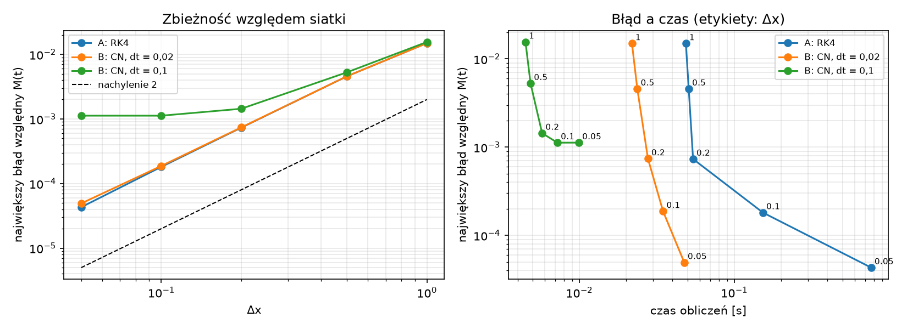
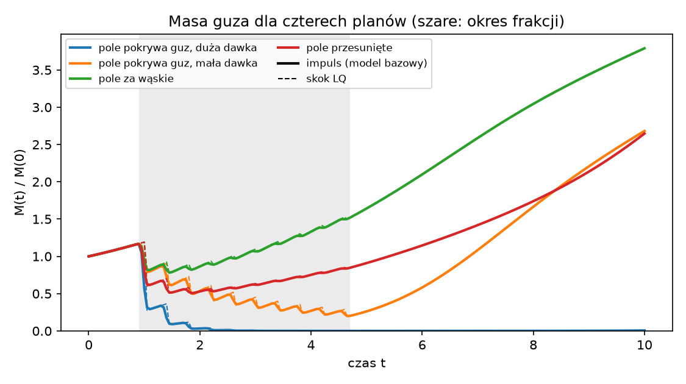
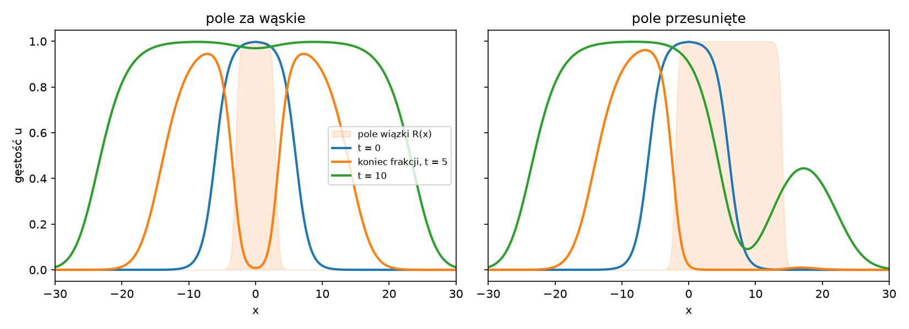
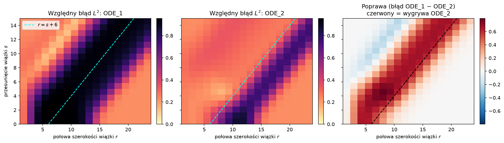
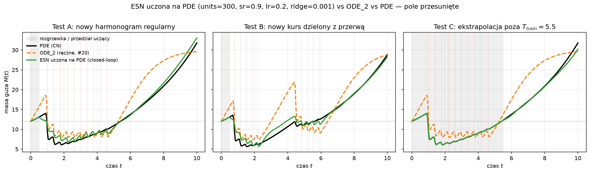
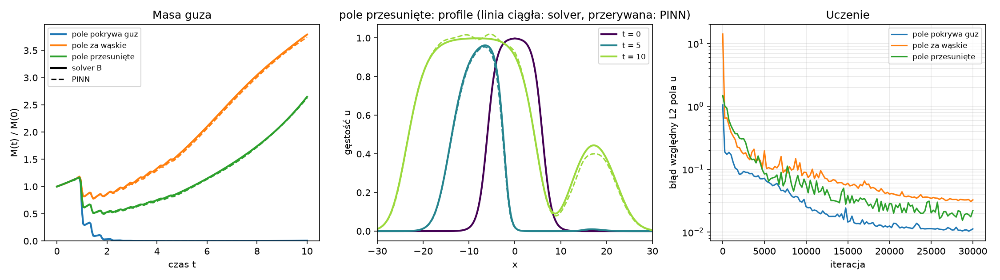

# Radioterapia guza przy niedopasowanym polu napromieniania

Krzysztof Kapera, Kacper Bieniasz · Informatyka Systemów Złożonych, AGH 2026/27 · prowadzący W. Dzwinel

Opis projektu, który rośnie razem z nim: po każdym zadaniu dopisujemy wyniki do sekcji „Postęp”. Plan pracy jest w [PLANS.md](../PLANS.md).

## Problem

Guz nowotworowy nie ma ostrej granicy: komórki dzielą się i wnikają w sąsiednią tkankę, a obraz MRI pokazuje tylko jego gęstą część. Dlatego pole napromieniania łatwo ustawić za wąsko albo trochę obok guza. Model GliODIL odtwarza komórki także poza granicą widoczną w MRI (Balcerak i in. 2025). Dopasowanie trójwymiarowego modelu do jednego pacjenta trwa jednak dziesiątki minut: w GliODIL 45 ± 20 min na pacjenta na GPU (tamże, s. 14).

**Pytanie projektu:** co dzieje się z guzem, gdy pole napromieniania nie pokrywa go dokładnie, i czy da się to przewidzieć szybko, szybszym modelem zastępczym zamiast pełnego solvera.

Temat z listy prowadzącego: „Radioterapia — wpływ niedopasowania pola promieniowania do guza”.

## Model

```latex
\frac{\partial u}{\partial t} = D\,\nabla^2 u + \rho\, u\left(1-\frac{u}{K}\right) - \beta\, R(x)\, U(t)\, u
```

| Człon | Znaczenie |
| --- | --- |
| u(x, t) | gęstość komórek guza w miejscu x i chwili t |
| D∇²u | naciekanie: komórki wędrują do sąsiedniej tkanki |
| ρu(1 − u/K) | wzrost: komórki dzielą się, aż wypełnią dostępne miejsce K |
| βR(x)U(t)u | radioterapia: R(x) to pole wiązki, U(t) harmonogram dawek, β wrażliwość komórek |

Liczymy w 1D, w jednostkach bezwymiarowych: czas w 1/ρ, długość w √(D/ρ), gęstość w K (przeliczenie na dni i mm niżej, w „Jednostki i zakresy parametrów”). 2D tylko, jeśli starczy czasu.

**Dawka.** Każda frakcja to wąski impuls w U(t) o całce 1, więc w środku wiązki jedna frakcja zostawia ułamek e^(−β) komórek (S = exp(−∫βU dt)). Dawki zapisane jako gładkie impulsy mają też Szubert, Bialy, Dzwinel (eq. 1–4). Odpowiednik modelu liniowo-kwadratowego to β = α·d + β_LQ·d²: dla frakcji 2 Gy i parametrów z TumorTwin (α = 0,05 Gy⁻¹, β_LQ = 0,005 Gy⁻²) β ≈ 0,12.

**Pokrętła i czego się spodziewamy:**

| Parametr | Co opisuje | Spodziewany wpływ |
| --- | --- | --- |
| D | naciekanie tkanki | szerszy i szybszy front; bez leczenia biegnie z prędkością 2√(Dρ) |
| ρ | tempo podziałów | szybszy wzrost przed leczeniem i szybszy odrost po nim |
| β | wrażliwość na promieniowanie | jaka część komórek ginie w jednej frakcji |
| r | połowa szerokości pola | za wąskie pole: guz odrasta z obu brzegów |
| s | przesunięcie pola względem guza | odrost po stronie, której pole nie objęło |
| U(t) | liczba i odstęp frakcji | granica między zanikiem a częściową odpowiedzią |

**Co mierzymy:** masę guza M(t) = ∫u dx, najmniejszą masę po leczeniu, czas do odrostu i położenie frontów.

### Jednostki i zakresy parametrów

Jednostki modelu bierzemy od pacjenta odniesienia z Swanson i in. 2008: ρ₀ = 0,012/dzień i mediana D/ρ = 9,83 mm², czyli D₀ = 0,118 mm²/dzień. Jednostka czasu to wtedy 1/ρ₀ = 83,3 dnia, jednostka długości √(D₀/ρ₀) = 3,14 mm, a front biegnie z prędkością 2√(D₀ρ₀) = 0,075 mm/dzień. Pacjent o innych D i ρ ma w modelu D/D₀ i ρ/ρ₀. β na frakcję jest w obu układach to samo, bo impuls dawki ma całkę 1 w każdych jednostkach czasu. Przeliczenia i zakresy są w kodzie: `src/offtarget/units.py`.

**Wartości z literatury** (D w mm²/dzień, ρ w 1/dzień):

| Wielkość | Fizycznie | W modelu | Źródło |
| --- | --- | --- | --- |
| D_w, rozkład a priori (log-jednostajny) | 0,013–3,8 | 0,11–32 | Lipková i in. 2019, mat. uzup. sec. A (za Harpold i in. 2007) |
| D_w, MAP dla 8 pacjentów | 0,060 (P2) – 2,447 (P5) | 0,51–20,7 | tamże, mat. uzup. tab. I |
| ρ, rozkład a priori (log-jednostajny) | 0,0027–0,19 | 0,23–15,8 | tamże, mat. uzup. sec. A |
| ρ, MAP dla 8 pacjentów | 0,007 (P7) – 0,107 (P5) | 0,58–8,9 | tamże, mat. uzup. tab. I |
| D w istocie szarej | D_g = D_w / 10 | | tamże, sec. II-A |
| ρ przyjęte dla 70 pacjentów | 0,012 | 1 (odniesienie) | Swanson i in. 2008, „Data analysis” |
| D/ρ z MRI, 70 pacjentów | mediana 9,83 mm², zakres 0,24–35,92 mm² | √(D/ρ) = 3,14 mm (odniesienie), zakres 0,49–5,99 mm | tamże |
| prędkość frontu | mediana 0,075 mm/dzień, zakres 0,0118–0,1438 | 2 (odniesienie), zakres 0,31–3,8 | tamże; liczona wzorem Fishera z D/ρ i ρ = 0,012, więc to nie niezależny pomiar |
| TumorTwin, pacjent in silico | k = 0,05, D = 0,1* | ρ = 4,17, D = 0,85 | Kapteyn i in. 2025, sec. 4.2 |
| α_RT, β_RT | 0,05 Gy⁻¹, 0,005 Gy⁻² (α/β = 10 Gy) | β = 0,12 na frakcję 2 Gy | tamże, sec. 4.2 |
| α na start kalibracji (LUMIERE) | 0,025 Gy⁻¹ przy α/β = 10 Gy | β = 0,06 na frakcję 2 Gy | repo TumorTwin, `examples/lumiere_pipeline.py` |
| schemat | 30 × 2 Gy, 5 dni w tygodniu przez 6 tygodni | odstęp 0,012 (przez weekend 0,036), cały kurs 0,47 | Kapteyn i in. 2025, sec. 4.1 |
| margines CTV wg RTOG | 2 cm wokół widocznego guza | 6,4 | Lipková i in. 2019, sec. III-C |
| margines CTV w GliODIL | 15 mm | 4,8 | Balcerak i in. 2025 (GliODIL) |

\* Jednostka D w TumorTwin jest niespójna: sec. 2.2.3 podaje mm²/dzień, a sec. 4.2 mm²/s. Przyjmujemy mm²/dzień, bo tylko ta mieści się w zakresach Lipkovej.

**Zakresy do przeglądów parametrów (#12) i analizy wrażliwości (#27)**, w jednostkach modelu (`model_ranges()` w `units.py`):

| Parametr | Zakres | Pacjent odniesienia | Uwagi |
| --- | --- | --- | --- |
| D | 0,11–32 | 1 | losować log-jednostajnie, jak w rozkładzie a priori Lipkovej |
| ρ | 0,23–15,8 | 1 | jw. |
| β na frakcję 2 Gy | 0,06–0,12 | 0,12 | α = 0,025–0,05 Gy⁻¹ przy α/β = 10 Gy |
| harmonogram | `clinical_schedule()` | 30 frakcji co 0,012, przerwy weekendowe | impuls szeroki na 0,05 dnia |

Prostokąt D × ρ zawiera pary, dla których D/ρ (od 0,07 do 1400 mm²) wychodzi daleko poza zmierzone u Swanson (0,24–35,92 mm²). Czy SA ma losować z prostokąta, czy ograniczyć D/ρ, rozstrzygamy w #27.

**Ilustracja z 23.10 w jednostkach fizycznych** (pacjent odniesienia):

| Wielkość | W modelu | Fizycznie |
| --- | --- | --- |
| promień guza | 6 | 19 mm |
| obszar | 80 | 251 mm |
| połowa szerokości pola r | 20 / 8 / 3 | 63 / 25 / 9,4 mm |
| przesunięcie pola s | 6 | 19 mm |
| szerokość półcienia w | 0,5 | 1,6 mm |
| odstęp frakcji | 0,4 | 33 dni (klinicznie 1 dzień) |
| szerokość impulsu | 0,05 | 4,2 dnia |
| czas symulacji | 10 | 833 dni |
| β na frakcję | 1,5 / 0,45 | tyle co jedna frakcja 13 / 5,7 Gy (klinicznie 2 Gy, β = 0,12) |

Wnioski:

- **Dawki i harmonogram ilustracji są dalekie od klinicznych.** Frakcje są 33 razy rzadsze, a każda zabija ok. 12 razy więcej w skali logarytmicznej (β = 1,5 wobec 0,12). Łącznie ilustracja daje β = 15, a kliniczny kurs 30 × 2 Gy tylko 1,8–3,6: bez wzrostu w trakcie kursu w polu przeżyłoby 3–17% komórek.
- **Kliniczny kurs trwa 0,47 jednostki czasu.** Domyślna szerokość impulsu w `Schedule` (0,05, czyli 4,2 dnia) jest wtedy większa od odstępu między frakcjami i impulsy by się nakładały. Dlatego `clinical_schedule()` podaje szerokość w dniach.
- **Ta sama geometria w mm to u różnych pacjentów inne r i s w modelu.** Skala długości √(D/ρ) zmienia się u Swanson od 0,5 do 6 mm, więc margines 2 cm to w modelu od 3,3 do 41 jednostek.

## Trzy sytuacje

| Sytuacja | Czego się spodziewamy |
| --- | --- |
| Pole pokrywa guz | przy dużej dawce guz znika |
| Pole za wąskie | oba brzegi guza są poza polem, guz odrasta z obu stron |
| Pole przesunięte | jedna strona guza jest poza polem, guz odrasta po tej stronie |

Uzasadnienie: poza polem R(x) = 0, więc człon radioterapii znika. Komórki, które tam zostały, dalej się dzielą i wędrują z powrotem w leczony obszar.

Pierwsza symulacja (`notebooks/00_start_scenariusze.ipynb`) potwierdza to jakościowo. Dawki są w niej ilustracyjne (β = 1,5 i 0,45, frakcje co 0,4 jednostki czasu), a nie kliniczne; przeliczenie na dni, mm i Gy jest w „Jednostki i zakresy parametrów”.


## Literatura

| Praca | Co z niej bierzemy |
| --- | --- |
| Rockne i in., J. Math. Biol. 58 | Model glejaka z radioterapią. Rok 2009 i postać członu −R·c(1 − c) znamy tylko ze źródeł wtórnych (Martín-Landrove 2017, eq. 61–63). Nasz człon jest wykładniczy (−βRUu), czyli taki, jaki Martín-Landrove proponuje w miejsce oryginału. |
| Unkelbach i in. 2014, Phys. Med. Biol. 59, 747 | Pole napromieniania wyznaczane z modelu wzrostu guza, a nie tylko z obrazu |
| Balcerak i in. 2025, Nature Communications 16:5982 (GliODIL) | Plan z modelu obejmuje 67,8% późniejszego nawrotu, standardowy margines 15 mm 63,6% (rys. 5d, 152 pacjentów); koszt 45 ± 20 min na pacjenta (s. 14) |
| Szubert, Bialy, Dzwinel 2026, wersja robocza (AGH) | To samo równanie w 2D, ale z terapią jednorodną w przestrzeni, bez profilu wiązki R(x) (eq. 1–4). Dwa modele zastępcze: VAE (100 symulacji w 0,77 s wobec 17 s solvera, tab. 4) i PINN osobny dla każdego scenariusza (sec. 7–9) |
| Lipková i in. 2019, IEEE TMI 38 | Plan dopasowany do pacjenta i miara skuteczności planu η = \|V_REC ∩ CTV\| / V_REC (sec. III-C, eq. 11); zakresy D i ρ (mat. uzup. sec. A, tab. I) |
| Swanson, Rostomily, Alvord 2008, Br J Cancer 98:113–119 | ρ = 0,012/dzień i D/ρ z MRI 70 pacjentów: skale jednostek modelu |
| Kapteyn i in. 2025, arXiv 2505.00670 (TumorTwin) | Dawka jako skok LQ (eq. 5), α i β_LQ, schemat 30 × 2 Gy (sec. 4.1–4.2) |

Prędkość frontu 2√(Dρ) bez leczenia podaje Martín-Landrove 2017 (eq. 6); nasz solver ją potwierdza.

Notatki z literatury do kolejnych zadań trafiają do `literatura.md` (issue #17 i #26).

## Dane

Na razie syntetyczne: z naszego solvera, w kilku chwilach i z szumem, tak jak kolejne badania MRI. Z jednego obrazu da się wyznaczyć tylko stosunek D/ρ (Lipková i in. 2019, sec. III-A), więc w asymilacji danych używamy co najmniej dwóch migawek przed leczeniem.

## Postęp

| Data | Zadanie | Stan |
| --- | --- | --- |
| 23.10 | 1. Literatura, model PDE i jego zachowanie | zrobione |
| 6.11 | 2. Solvery i rozdzielczości, skrajne parametry, warunki brzegowe, uproszczenia członów | zrobione: dwa solvery, dwa modele dawki, tabela błąd a czas, scenariusze (niżej); warunki brzegowe, skrajne parametry, uproszczenia członów, mapa niedopasowania i generator danych mają kod, testy i wyniki w `results/` (notatniki `zad2_02_warunki`–`zad2_06_mapa`), opis wyników dopiszemy w osobnej sekcji |
| 20.11 | 3. Surogat ODE dla masy guza i sieć rezerwuarowa | zrobione: ODE_1, ODE_2 z ręcznym doborem parametrów, ESN i opcjonalnie POD–Galerkin (niżej); brak jeszcze slajdów z prezentacji (#23) |
| 4.12 | 4. Analiza wrażliwości (Morris, Sobol), modele uproszczone; 5. asymilacja danych (ABC, 4D-Var) | do zrobienia |
| 18.12 | 6. NODE i UDE na modelu ODE | do zrobienia |
| 15.01 | 7–8. PINN, supermodel z modeli ODE, SuperNet z PINN-ów, porównanie wszystkich modeli | w toku: PINN z terapią odtwarza trzy scenariusze z błędem 1–3% (niżej) |

## Wyniki: Zadanie 2

**Solvery** (`src/offtarget/solvers.py`, notatnik `zad2_01_rozdzielczosc`):

- **A, RK4:** różnice centralne w x i jawny RK4. Krok czasu ogranicza warunek stabilności dyfuzji Δt ≤ 0,4·Δx²/D.
- **B, Crank-Nicolson:** rozszczepienie Stranga, czyli pół kroku reakcji, krok dyfuzji schematem Cranka-Nicolsona i pół kroku reakcji. Reakcja i dawka są liczone dokładnie w każdym węźle, więc krok czasu jest dowolny.
- Oba mają rząd zbieżności 2 w Δx i zbiegają do tego samego rozwiązania.
- Przy tej samej dokładności B jest ok. 16 razy szybszy (Δx = 0,05: 0,05 s wobec 0,76 s).
- Przy Δt = 0,1 B liczy w kilka milisekund z błędem masy ok. 10⁻³. To wystarczy do przeglądów parametrów.



**Testy** (`tests/test_solvers.py`, 16 testów): rząd zbieżności 2 wobec dokładnej fali biegnącej, zachowanie masy przy samej dyfuzji, frakcja przeżycia e^(−β) przy samym zabijaniu, prędkość frontu zgodna z 2√(Dρ) z poprawką Bramsona, zgodność solverów A i B.

**Scenariusze** (notatnik `zad2_02_scenariusze`, dawki ilustracyjne):

| Plan | Najmniejsza masa / M(0) | Czas do odrostu |
| --- | --- | --- |
| pole pokrywa guz, duża dawka | ≈ 0 | brak do t = 10 |
| pole pokrywa guz, mała dawka | 0,20 | 6,85 |
| pole za wąskie | 0,78 | 2,75, jeszcze w trakcie frakcji |
| pole przesunięte | 0,51 | 5,45 |

Pole za wąskie daje odrost z obu brzegów, pole przesunięte z nienapromienionej strony, tak jak przewidywaliśmy.

**Dwa modele dawki:** gładki impuls (model bazowy) i natychmiastowy skok LQ (jak w TumorTwin). Po leczeniu różnią się o najwyżej 0,4% masy, więc impulsy, wygodne dla PINN-ów, dobrze przybliżają skok.





## Wyniki: Zadanie 3

Surogaty liczą się na całkowitej masie guza M(t); jednostki i parametry jak w zadaniu 2 (Δx = 0,2 w porównaniach, solver CN). Kod: `src/offtarget/ode.py` i `src/offtarget/pod.py`, testy `tests/test_ode.py` i `tests/test_pod.py` (17 testów), literatura w `literatura.md` (#17).

**ODE_1: jeden przedział** (notatnik `zad3_01_ode`, #18). Całkujemy PDE po obszarze; przy warunkach Neumanna dyfuzja znika z całki. Żeby zamknąć równanie względem samego M, przybliżamy ∫u² dx ≈ M²/W_eff (stąd K_eff = K·W_eff) i ∫R·u dx ≈ c·M, gdzie c to stały ułamek guza w wiązce:

```latex
\frac{dM}{dt} = \rho M\left(1-\frac{M}{K_{\mathrm{eff}}}\right) - \beta\, c\, U(t)\, M
```

Gdy c ≈ 1 (pole pokrywa guz), ODE_1 dobrze oddaje spadek masy. Gdy część guza jest poza polem, model przeszacowuje leczenie: w PDE po pierwszej frakcji niemal cała pozostała masa leży poza wiązką i kolejne frakcje jej nie zabijają, a w ODE_1 stałe c tego nie widzi.

**ODE_2: dwa przedziały** (notatnik `zad3_01b_ode2`, #19). Masę dzielimy na M_in (w polu) i M_out (poza polem); dawka działa tylko na M_in, a dyfuzja wymienia komórki przez brzeg pola z tempem γ = γ₀·D:

```latex
\dot M_{\mathrm{in}}=\rho M_{\mathrm{in}}\left(1-\tfrac{M}{K_{\mathrm{eff}}}\right)-\beta U(t) M_{\mathrm{in}}+\gamma\,(c\,M_{\mathrm{out}}-(1-c)\,M_{\mathrm{in}}),\qquad
\dot M_{\mathrm{out}}=\rho M_{\mathrm{out}}\left(1-\tfrac{M}{K_{\mathrm{eff}}}\right)-\gamma\,(c\,M_{\mathrm{out}}-(1-c)\,M_{\mathrm{in}})
```

Dla γ → ∞ ODE_2 redukuje się do ODE_1, a dla c = 1 i M_out(0) = 0 oba modele są tożsame (sprawdzone testami). ODE_2 odtwarza odrost z nienapromienionego marginesu, którego ODE_1 w ogóle nie widzi.

**Ręczny dobór parametrów** (notatnik `zad3_01c_ode_porownanie`, #20). Bez optymalizatora: c = c₀ = ∫R·u₀ dx / ∫u₀ dx, K_eff przeglądany ręcznie po {25, 30, 35}, γ₀ po {0,4, 0,8, 1,2, 1,6}; do porównań K_eff = 30 i γ = 1,2·D.

| Scenariusz | M_min: PDE / ODE_1 / ODE_2 | Czas do odrostu: PDE / ODE_1 / ODE_2 | Błąd L2 M(t): ODE_1 / ODE_2 |
| --- | --- | --- | --- |
| pole pokrywa guz, duża dawka | 0 / 0 / 0 | brak | 23% / 23% |
| pole pokrywa guz, mała dawka | 2,39 / 3,41 / 3,41 | 6,85 / 6,35 / 6,35 | 18% / 18% |
| pole za wąskie | 9,38 / 0,33 / 11,87 | 2,75 / 8,8 / 1,5 | 78% / 23% |
| pole przesunięte | 6,08 / 0,03 / 7,90 | 5,45 / brak / 5,3 | 90% / 23% |

Na mapie (r, s) (18 × 18, r ∈ [1, 24], s ∈ [0, 15], β = 1,5) w strefie pełnego pokrycia oba modele mają błąd 18–23%, a w strefie niedopasowania ODE_2 wygrywa z ODE_1 pod względem trajektorii, M_min i czasu odrostu. Ograniczenia: stała pojemność K_eff nie oddaje liniowego poszerzania się fali Fishera (bez leczenia guz w PDE rośnie z 12 do 45,8), więc masa końcowa nasyca się za wcześnie; w wąskim pasie tuż pod przekątną mapy (r ≈ s + 8 … s + 12) błąd jest podwyższony, bo front dyfunduje poza pole jeszcze przed pierwszą frakcją, a c₀ tego nie zna. Dla „pole za wąskie” ODE_2 wypada gorzej na czasie odrostu (1,5 wobec 2,75).



**Sieć rezerwuarowa** (ReservoirPy, notatnik `zad3_02_esn`, #21). ESN dostaje (M(t), całka U na kroku) i przewiduje M(t + Δt). Uczymy ją na **danych z PDE** (7 harmonogramów leczenia), hiperparametry (units, sr, lr, ridge) wybieramy na dwóch osobnych harmonogramach walidacyjnych, a testujemy w pętli zamkniętej (własna predykcja wraca na wejście) na dwóch harmonogramach spoza treningu oraz w ekstrapolacji w czasie (uczenie tylko na t ≤ 5,5).

| Test | Błąd L2 M(t) względem PDE: ESN | ODE_2 | Czas do odrostu: PDE / ODE_2 / ESN |
| --- | --- | --- | --- |
| A: nowy harmonogram regularny | 5,6% | 22,7% | 5,45 / 5,3 / 5,45 |
| B: kurs dzielony z przerwą | 6,0% | 25,5% | 5,65 / 3,0 / 3,95 |
| C: ekstrapolacja t > 5,5 | 2,8% | 23,2% | 5,45 / 5,3 / 5,45 |

Sieć uczona na PDE jest dokładniejsza niż ręczne ODE_2 i podąża za dalszym wzrostem guza, którego ODE_2 nie oddaje (stała pojemność K_eff). Dla pięciu ziaren rezerwuaru błąd wynosi 4–5% (A), 8–13% (B) i 3–37% (C): nowe harmonogramy są stabilne, a ekstrapolacja zależy od ziarna (dwa z pięciu ziaren są gorsze od ODE_2), więc wynik C z ziarnem 42 jest optymistyczny, a mediana to ok. 12%. Przy słabej regularyzacji (ridge = 1e-5) ekstrapolacja potrafi się rozbiec. Testowano jedną geometrię wiązki (s = 6, r = 8) i jedno β.



**Opcjonalnie: POD–Galerkin** (`src/offtarget/pod.py`, notatnik `zad3_03_pod_galerkin`, #22). Baza POD z migawek PDE (4 scenariusze × 201 chwil), rzut Galerkina daje układ k równań ODE o strukturze liniowo-kwadratowej. Według notatnika 99% energii migawek mieści się w 5 modach, 99,9% w 9, a 99,99% w 12. Z bazą własną dla scenariusza błąd M(t) spada poniżej 1% dla k ≈ 8–12, ale zbieżność nie jest monotoniczna: dla małych k układ potrafi „wybuchnąć” (np. k = 3 dla pola za wąskiego), bo oscylacje û < 0 wzmacnia człon kwadratowy. Baza wspólna jest mniej stabilna, a dla geometrii wiązki spoza zbioru uczącego Galerkin najczęściej wybucha, choć sam rzut pola na bazę daje 2–4% błędu przy k = 20 (tabele `zad3_03_pod_galerkin*.csv`). Model zredukowany nie przenosi się więc wiarygodnie na inne R(x) bez stabilizacji.

## Wyniki wstępne: Zadanie 7

**PINN z terapią** (`src/offtarget/pinn.py`, notatnik `zad7_01_pinn_terapia`, issue #24). Sieć uczy się w = log(u/K) z samej reszty
równania, bez danych z solvera. Dostaje na wejściu x, t i liczbę frakcji podanych do chwili t; punkty kolokacji są losowane w każdej
iteracji i zagęszczone przy impulsach dawki. Jedno ziarno, 30 tys. iteracji.

| Scenariusz | Błąd L2 pola u | Największy błąd M(t) | M_min / M(0): solver, PINN | Czas do odrostu: solver, PINN |
| --- | --- | --- | --- | --- |
| pole pokrywa guz | 1,1% | 8,9% (przy masie ok. 3·10⁻⁵ M(0)) | 3,0·10⁻⁵, 2,7·10⁻⁵ | brak, brak |
| pole za wąskie | 3,3% | 2,8% | 0,78, 0,77 | 2,75, 2,85 |
| pole przesunięte | 2,2% | 3,0% | 0,51, 0,49 | 5,45, 5,5 |

Uczenie trwa ok. 4,4 min na scenariusz (GPU Apple), a solver B liczy cały przebieg w 0,03 s. Sieć uczona osobno dla każdego planu
się więc nie opłaca; sens ma dopiero sieć z parametrami planu na wejściu albo w zadaniu odwrotnym (#36, #42, #44).
Sieć ucząca się samego u przy tym horyzoncie (T = 10) dawała w eksperymentach do magisterki rozwiązanie trywialne u = 0.



## Prezentacje

Slajdy z każdej prezentacji trafiają do `prezentacje/RRRR-MM-DD_zadN/`. Wykresy bierzemy z `results/figures/`, żeby zawsze dało się je odtworzyć komendą `uv run reproduce`.
